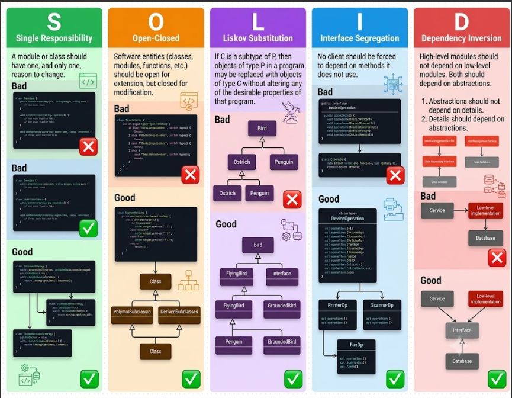

# Design Patterns

# What are Design Patterns

- Design patterns are typical solutions to commonly occurring problems in software design.
- It’s more of general concept for solving problems rather than a piece of code.
- Design patterns are high-level descriptions of solutions.

## SOLID Principles

- They improve the quality of software applications by making them robust and maintainable



## Single Responsibility Principle

- A class or module should have one, and only one, reason to change

**Real-World Example:** Consider an `Employee` class that contains methods for calculating salary, updating personal information, and sending emails.

- **Violation:** The `Employee` class has multiple reasons to change. If the email system or the tax calculation logic changes, the entire class is affected.
- **Refactoring:** You would split this into three distinct classes: an `Employee` class (managing data), a `PayCalculator` class (calculating pay), and an `EmailNotifier` class (sending messages).

## Open-Closed Principle

- Software entities (classes, modules, and functions) should be open for extension but closed for modification
- In other words, you can add new features to a system without changing its existing source code

**Real-World Example: A Payment Processing System.**

Imagine you are building an e-commerce website.

### 1. The "Bad" Way (Violates OCP)

You create a `PaymentProcessor` class with a large `if/else` or `switch` statement to handle different payment types.

```java
if (paymentType == "CreditCard") {
    process_card();
} else if (paymentType == "PayPal") {
    process_paypal();
}
```

**The problem:** If you want to add a new payment method later (like Apple Pay or Crypto), you must **modify** this existing `PaymentProcessor` class by adding another `if` statement. This risks breaking the existing payment methods.

### 2. The "Good" Way (Follows OCP)

You apply OCP by creating a standardized **Interface** for all payment types.

- You create a base contract like `PaymentMethod` that requires an `execute()` method.
- Every payment type is made into its own separate class that implements this contract (e.g., `CreditCardPayment`, `PayPalPayment`, and a new `ApplePayPayment`).
- **The result:** Your core `PaymentProcessor` code doesn't need to be changed at all. When a new payment method is invented, you simply **extend** the system by writing a new class and plugging it in.

## Liskov Substitution Principle

- If C is a subtype of P, then objects of type P in a program may be replaced with objects of type C without altering any of the desirable properties of that program
- Objects of a superclass should be replaceable with objects of a subclass without breaking the application.
- If your program works with a base class, substituting a child class should not cause unexpected bugs or alter the program's correctness.

### Real-World Example: An Order Management System.

Imagine you are building an e-commerce website.

### 1. The "Bad" Way (Violates LSP)

You create a base `Order` class, but you force all order types to handle shipping costs, even if they don't have any.

```java
if (orderType == "HomeDelivery") {
    return price + shipping_cost();
} else if (orderType == "PickUp") {
    throw new Error("PickUp orders don't have shipping costs!");
}
```

**The problem:** If a function expects a standard `Order` and calls `getShippingCost()`, passing a `PickUpOrder` will unexpectedly crash your application with an exception. A subclass should **never** break the behavior expected from its parent.

### 2. The "Good" Way (Follows LSP)

You apply LSP by segregating behavior using targeted **Interfaces** so that objects can be substituted without causing errors.

- You create a core contract like `Order` that only handles universal behaviors (e.g., `calculateTotal()`).
- Every order type is made into its own separate class that implements this contract (e.g., `PickUpOrder`, `HomeDeliveryOrder`).
- You create a separate interface named `Shippable` **only** for orders that require shipping calculations.
- **The result:** Your code becomes completely safe. Any function interacting with the base `Order` interface can process any order type smoothly without checking for unexpected errors or exceptions.

## Interface Segregation Principle

- No class should be forced to depend on methods it does not use. It advocates for splitting large, "fat" interfaces into smaller, role-specific ones, ensuring that implementing classes only need to concern themselves with the behaviors relevant to them.

### Real-World Example: A Task Management System.

Imagine you are building a project management app.

### 1. The "Bad" Way (Violates ISP)

You create a bloated, fat interface like `TaskManager` that forces all implementing classes to look after task creation, assignment, and notifications simultaneously.

```java
interface TaskManager {
  void createTask(String taskName);
  void assignTask(String taskName, String assignee);
  void sendNotification(String message, String recipient);
}

// ❌ Client is forced to implement sendNotification
// even if they only need core task logic
class SimpleTaskService implements TaskManager {
  public void createTask(String taskName) { /* Logic */ }
  public void assignTask(String taskName, String assignee) { /* Logic */ }

  public void sendNotification(String message, String recipient) {
    // ❌ Violation: This service doesn't handle notifications,
    // but it's forced to write dummy code!
    throw new Error("Notifications not supported here.");
  }
}
```

**The problem:** Classes are forced to depend on methods they do not use. If you want to create a lightweight offline service, you are still dragged into implementing email/notification logic just to satisfy the contract.

### 2. The "Good" Way (Follows ISP)

You apply ISP by breaking down the fat interface into smaller, focused, and highly specific role interfaces.

- You split `TaskManager` into three distinct interfaces: `TaskCreator`, `TaskAssigner`, and `NotificationSender`.
- Every service can now pick, choose, and implement **only** what it actually needs.

```java
interface TaskCreator {
  void createTask(String taskName);
}

interface TaskAssigner {
  void assignTask(String taskName, String assignee);
}

interface NotificationSender {
  void sendNotification(String message, String recipient);
}

// ✅ Clean & lightweight: only handles core tasks
class SimpleTaskService implements TaskCreator, TaskAssigner {
  public void createTask(String taskName) { /* Logic */ }
  public void assignTask(String taskName, String assignee) { /* Logic */ }
}

// ✅ Advanced service: implements all independent interfaces smoothly
class AdvancedTaskService implements TaskCreator, TaskAssigner, NotificationSender {
  public void createTask(String taskName) { /* Logic */ }
  public void assignTask(String taskName, String assignee) { /* Logic */ }
  public void sendNotification(String message, String recipient) { /* Logic */ }
}
```

**The result:** Clients are no longer burdened with maintaining unused methods. The code becomes highly modular, decoupled, and reusable.

## Dependency Inversion Principle

- High-level modules should not depend on low-level modules. Both should depend on abstractions.
- Abstractions should not depend on details. Details should depend on abstractions.

### Real-World Example: An Order Management Service.

Imagine you are managing data fetching operations for orders within a business module.

### 1. The "Bad" Way (Violates DIP)

Your high-level module (`OrderManagementService`) tightly couples itself by directly instantiating a low-level concrete class (`OrderDataAccess`) using the `new` keyword.

```java
// Low-level concrete class
class OrderDataAccess {
  public void fetchOrders() {
    // Logic to fetch order data from a specific database
  }
}

// High-level module tightly coupled to a concrete implementation
class OrderManagementService {
  private OrderDataAccess orderDataAccess;

  public OrderManagementService() {
    // ❌ Violation: High-level module depends directly on a low-level detail!
    this.orderDataAccess = new OrderDataAccess();
  }

  public void doBusinessLogic() {
    this.orderDataAccess.fetchOrders();
  }
}
```

**The problem:** This architecture matches a layout where the service points straight down into a hardcoded database implementation. If you decide to switch your database from MySQL to MongoDB, you will be forced to modify the internal code of `OrderManagementService`. High-level business rules should never depend on low-level database details.

### 2. The "Good" Way (Follows DIP)

You apply DIP by introducing an abstraction layer between the high-level and low-level components.

- You introduce an abstraction contract like the `DataProvider` interface.
- Both your high-level service and low-level modules depend solely on this abstract layer.
- You inject the dependency via the constructor (**Dependency Injection**).

```java
// The Abstraction layer
interface DataProvider {
  void fetchData();
}

// Low-level implementations conforming to the abstraction
class OrderMySQLDataAccess implements DataProvider {
  public void fetchData() {
    // Logic to fetch from MySQL database
  }
}

class OrderMongoDataAccess implements DataProvider {
  public void fetchData() {
    // Logic to fetch from MongoDB database
  }
}

// High-level module depends only on the abstraction
class OrderManagementService {
  private DataProvider dataProvider;

  // ✅ Inverting control: passing the abstraction interface through the constructor
  public OrderManagementService(DataProvider dataProvider) {
    this.dataProvider = dataProvider;
  }

  public void doBusinessLogic() {
    this.dataProvider.fetchData(); // Works dynamically with any provider passed in
  }
}
```

**The result:** Your core business logic is completely decoupled. You can pass an instance of `OrderMySQLDataAccess` or `OrderMongoDataAccess` seamlessly at runtime without modifying a single line of code inside `OrderManagementService`.
