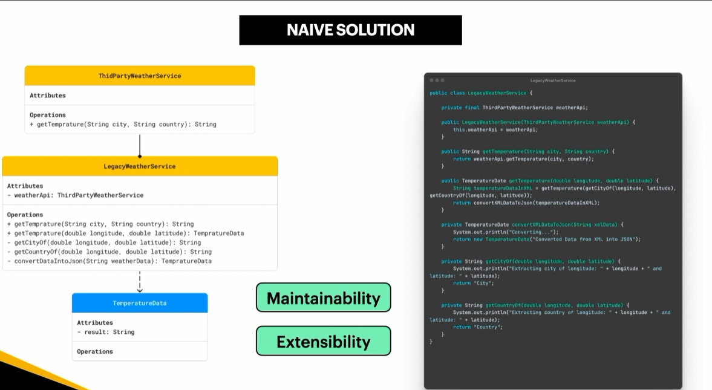
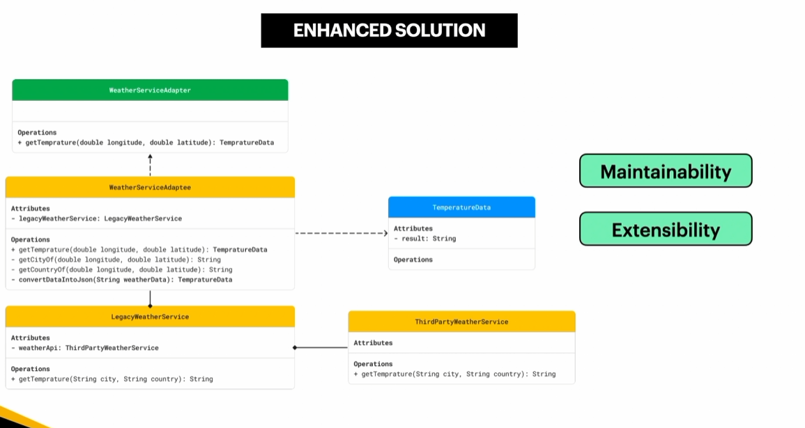
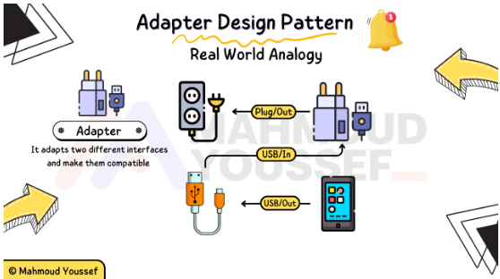

## Adapter

- Adapter Design Pattern is a structural software design pattern that allows two incompatible interfaces to work together by acting as a bridge or wrapper between them.
    - **Target Interface**: The domain-specific interface that the client code expects to use.
    - **Client**: The code that interacts with objects conforming to the target interface.
    - **Adaptee**: The existing class or third-party library with an incompatible interface that needs integration.
    - **Adapter**: The intermediary class that implements the target interface while wrapping or inheriting from the adaptee to translate calls

### Adapter Applicability — When to Use

- When Two Incompatible Interfaces Need to Work Together: Use the Adapter Pattern when two classes or systems have different interfaces, and you need them to work together without modifying their existing code.
- When Integrating Third-Party Services: Use the Adapter Pattern when integrating an external API or third-party service. The adapter acts as an intermediate layer that maps data and translates requests or responses between your application and the external service.

Example: We want to integrate a third-party weather service into an existing application. The third-party service retrieves temperature data using a city and country, while our application expects temperature data based on longitude and latitude. Instead of modifying the existing service or changing the application's code, we can introduce a WeatherServiceAdapter to bridge the two interfaces. The adapter translates the application's requests into the format supported by the legacy service and converts the returned data into the expected format. This approach improves maintainability and extensibility, making it easier to integrate new weather providers or modify existing implementations without affecting the rest of the application.





#### **Adapter in Action - Common Libraries and Frameworks**

- One example of a library that demonstrates concepts related to the Adapter Pattern is Spring Data JPA, which simplifies database access in Spring applications by providing a higher-level abstraction over the Java Persistence API (JPA).
- Spring Data JPA allows developers to define Repository Interfaces that provide methods for interacting with database entities without writing repetitive data access code. It integrates Spring's repository abstraction with JPA implementations, reducing the need to handle low-level persistence operations directly.
- Here is a simple example of how Spring Data JPA simplifies database access:

```java
import org.springframework.data.jpa.repository.JpaRepository;
import java.util.List;

public interface ProductRepository
        extends JpaRepository<Product, Long> {

    List<Product> findByCategory(String category);
}

import org.springframework.stereotype.Service;
import java.util.List;

@Service
public class ProductService {

    private final ProductRepository productRepository;

    public ProductService(ProductRepository productRepository) {
        this.productRepository = productRepository;
    }

    public List<Product> getProductsByCategory(String category) {
        return productRepository.findByCategory(category);
    }
}
```

- `JpaRepository`: Provides common database operations, such as saving, finding, and deleting entities, through a consistent repository interface.
- `findByCategory()`: Spring Data JPA derives a query from the method name and uses it to retrieve products matching the specified category.
- Abstraction: The application works with repository methods instead of manually implementing repetitive database access logic.
- Spring Data JPA is not strictly an implementation of the classic Adapter Pattern in this example. It primarily provides a repository abstraction and integrates with JPA. The Adapter Pattern specifically involves making incompatible interfaces work together, so it is more accurate to describe Spring Data JPA as an example of abstraction and integration that may involve adapter-like mechanisms internally.

#### **Adapter - Real World Analogy**



الـ Adapter بيشبه الـ **Adapter اللي بنستعمله كل يوم في حياتنا عشان نشحن الأجهزة الالكترونية** وده من خلال انه **بيعرف يـ Map الـ Input والـ Output لمصادر الكهرباء المختلفة**