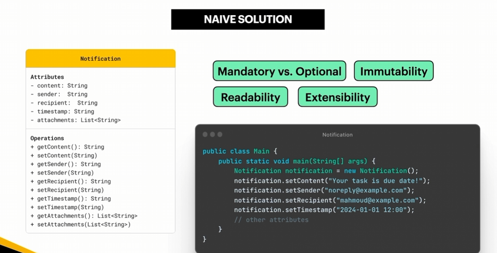
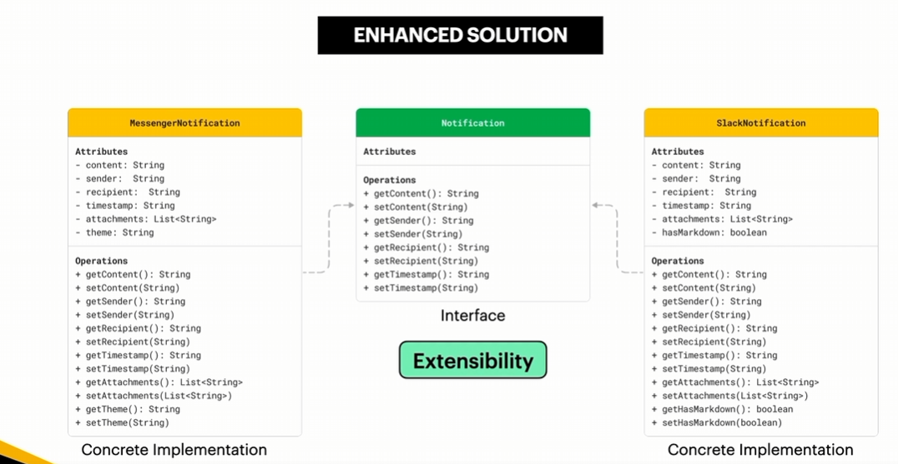
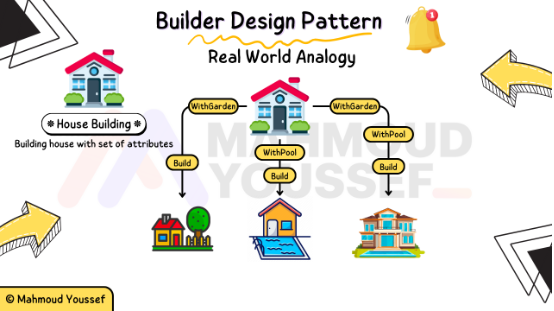

## Builder

- The **Builder Design Pattern** is **a creational design pattern that allows you to construct complex objects step-by-step**. It separates an object's construction logic from its actual representation, enabling the same construction process to create different variations of an object.
- The pattern can be implemented in a strict, classic architectural layout (GoF style) or a modern fluent style.
    - **Product:** The complex object being built.
    - **Builder:** An interface or an internal class specifying the steps to build the product.
    - **Concrete Builder:** The exact implementation that tracks construction state and returns the product.
    - **Director (Optional):** A coordinator class that dictates the execution sequence of building steps (e.g., `buildPremiumUser()`, `buildGuestUser()`).

### Builder Applicability — When to Use

- When you want to create different representations of the same class depending on specific configurations or requirements, while keeping the object construction process flexible.
- When you want to avoid constructor overloading and handle optional parameters without creating multiple constructors with different combinations of arguments.
- When you need to construct complex objects with many attributes, the Builder Pattern makes the construction process more readable, organized, and easier for clients to use.
- When working with Unit Tests, especially when creating reusable test objects with different configurations. Builders make it easier to prepare test data and create objects with specific attributes for different test scenarios.
- When you need to validate an object's configuration before creating the final object, the Builder Pattern allows you to perform validation during the build process and ensure that the resulting object satisfies the required criteria.

Example: We want to design a `Notification` system capable of creating messages with multiple fields, including `content`, `sender`, `recipient`, `timestamp`, and `attachments`. In a direct, "naive" approach, we instantiate an empty object and set each attribute individually using multiple setter methods. While simple, this approach struggles to enforce requirements like distinguishing mandatory parameters from optional ones, maintaining object immutability, preserving code readability, and allowing clean extensibility as new attributes are added. To solve these issues and avoid complex, unwieldy constructors, design patterns like the **Builder Pattern** are typically introduced as a cleaner, more flexible alternative.







#### **Builder in Action - Common Libraries and Frameworks**

- One of the common libraries that utilizes the Builder Design Pattern is Apache HttpClient, particularly when configuring HTTP clients and constructing HTTP requests.
- The Builder Pattern allows us to configure multiple properties, such as the URI, HTTP method, headers, and timeout settings, step by step before creating the final object.
- Here is a simple example of how Apache HttpClient uses the Builder Pattern:

```java
import org.apache.hc.client5.http.config.RequestConfig;
import org.apache.hc.client5.http.classic.methods.HttpGet;
import org.apache.hc.core5.util.Timeout;

import java.net.URI;

public class Main {
    public static void main(String[] args) throws Exception {

        HttpGet request = new HttpGet(
            URI.create("https://example.com/api/users")
        );

        request.setHeader("Accept", "application/json");

        RequestConfig config = RequestConfig.custom()
            .setResponseTimeout(Timeout.ofSeconds(5))
            .build();

        System.out.println("HTTP Method: " + request.getMethod());
        System.out.println("Request URI: " + request.getUri());
    }
}
```

- `RequestConfig.custom()` / `build()` Methods: These allow us to configure request settings step by step and then create the final configuration object.
- `HttpGet`: Represents an HTTP GET request and allows us to specify the target URI and configure request headers.
- Step-by-Step Configuration: Instead of passing many parameters to a constructor, the Builder Pattern provides a readable and flexible way to configure complex objects before building them.
- Apache HttpClient uses the Builder Pattern extensively, including `HttpClientBuilder` and `RequestConfig.Builder`. The example above demonstrates building a request configuration; the request itself is created using the `HttpGet` constructor.

#### **Builder - Real World Analogy**



الـ Builder عامل شبه البيت اللي بيتبنى فاحنا ممكن نبني بيت ومن نفس المكونات نبني بيت ونزود عليه جنينة وممكن يبقى عندنا بيت ونبني فيه حمام سباحة وممكن نبني بيت يكون فيه حمام سباحة وجنينة