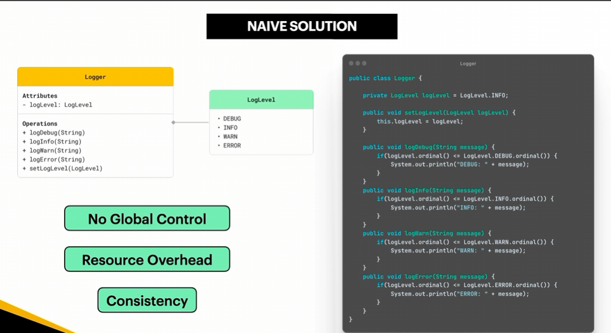
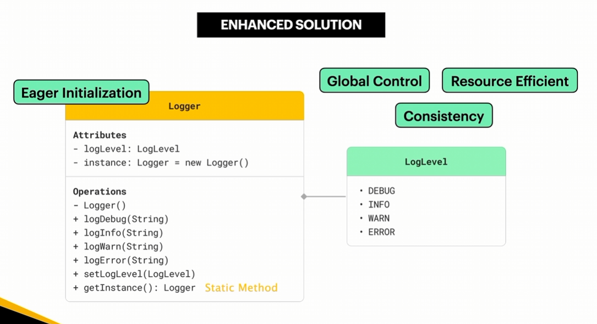

## Singleton

- Singleton design pattern is a creational software design pattern that ensures a class has only one instance and provides a global point of access to it
    - **Private Constructor:** Blocks external code from using `new` to instantiate the class directly.
    - **Static Member/Variable:** Holds the single reference to the class instance in memory.
    - **Static Factory/Access Method:** Provides a global gateway (`getInstance()`) that either creates the instance if it does not exist or returns the existing one.

### Observer Applicability — When to Use

- When your application requires only one instance of a class to be shared across different parts of the application. For example, a Database Connection Manager can be implemented using the Singleton Pattern to provide a shared instance that manages database connections.
- When you need to have centralized control over a shared resource or global state instead of relying on global variables. The Singleton Pattern provides a single access point to that instance, allowing you to control how it is created and accessed throughout the application.

Example: We want to develop a logging system for an application where different parts of the application need to record messages at different log levels, such as DEBUG, INFO, WARN, and ERROR. We want to ensure that all parts of the application share the same Logger instance, allowing centralized control over the logging configuration and maintaining consistency across the system. Instead of creating multiple Logger objects, we can use the Singleton Pattern to provide a single shared instance, reduce unnecessary resource usage, and ensure consistent logging behavior throughout the application.





#### **Singleton in Action - Common Libraries and Frameworks**

- One of the common Java APIs that utilizes the Singleton Pattern is `java.util.logging.Logger`, particularly through the `Logger.getLogger()` method.
- In Java, you can use the `Logger.getLogger(name)` static method to retrieve a logger associated with a specific name. Repeated calls with the same name return the same logger instance within the same logger context, allowing different parts of an application to share the same logger.
- Here is a simple example of how Java utilizes the Singleton Pattern:

```java
import java.util.logging.Logger;

public class Main {
    public static void main(String[] args) {
        // Retrieve a logger instance with the name "MyLogger"
        Logger logger1 = Logger.getLogger("MyLogger");

        // Retrieve the logger instance with the same name
        Logger logger2 = Logger.getLogger("MyLogger");

        // Check whether both references point to the same instance
        System.out.println(logger1 == logger2); // true

        // Log a message
        logger1.info("Application started");
    }
}
```

- `Logger.getLogger()` Method: This static method retrieves a logger associated with the specified name. If a logger with that name already exists in the same logger context, the existing instance is returned; otherwise, a new logger may be created.
- Shared Logger Instances: Different classes can retrieve and use the same named logger, allowing them to share logging configuration and behavior across the application.
- `Logger` is not a textbook Singleton in the strict sense because the API allows multiple logger instances with different names. Instead, it demonstrates the named-instance reuse concept, which is related to the Singleton Pattern.

#### **Singleton - Real World Analogy**


بيشبه رئيس الدولة فكل دولة بيكون ليها رئيس دولة واحد بس وهو اللي بايده أعلى الصلاحيات
